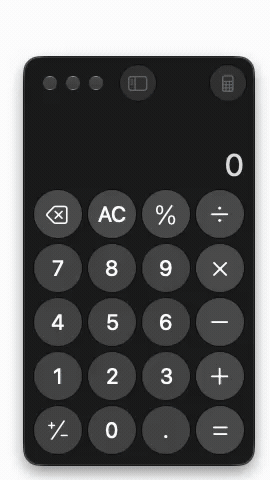

# OpenCUA

English | [简体中文](README.zh-CN.md)

[](LICENSE)
[](#requirements)
[](#requirements)
[](#how-it-works)


OpenCUA takes the repetitive clicking off your hands. It lets an AI agent drive
native macOS apps the way you would — pressing buttons, filling fields, sending key
chords, scrolling, dragging — while you get on with something else.

It runs on your own Mac, a local service rather than a cloud VM, and plugs in as an
MCP server, a CLI, or a plain JavaScript client, so whatever agent you already use
can drive it. What sets it apart is that you **never hand over the machine**: input
is injected straight into the target process — no window comes forward, the real
pointer stays put, keyboard focus is never taken — so an agent can work in one
window while you keep typing in another. And the run stays legible, with a blue
outline and a standing "OpenCUA is operating …" badge that hold until the run ends.

<p align="center">
  
</p>

---

## Install with one sentence

Copy this and send it to your agent. That is the entire setup:

```
Set yourself up with OpenCUA, a local computer-use service for macOS, so you can
drive native apps:

  git clone https://github.com/YuzuSa1t/computer-use-for-mac.git ~/.opencua/src && \
    bash ~/.opencua/src/scripts/install.sh

Then register yourself as an MCP client using the snippet the script printed.
Next, ask me to grant Accessibility and Screen Recording to "OpenCUA Helper" in
System Settings, and run `node ~/.opencua/src/server/cua.mjs doctor` until
"all_granted" is true. Finally, open Calculator and press 7 to prove it works.
```

The agent clones, builds, installs, registers itself, and reports back. You do the
one thing a program is not allowed to do: **click Allow twice**. No API keys, no
`npm install`, no background daemon, no account.

When it says `"all_granted": true`, it is ready.

<details>
<summary>Prefer to do it yourself?</summary>

```bash
git clone https://github.com/YuzuSa1t/computer-use-for-mac.git
cd opencua && ./scripts/install.sh
```

`install.sh` builds the helper, installs it to `~/.opencua/bin/`, starts it,
checks permissions, opens the right System Settings pane if something is missing,
and prints registration snippets for your agent. Then verify:

```bash
node server/cua.mjs doctor     # "all_granted": true means both grants are set
```
</details>

---

## Why it feels different

> Give your agent hands on the Mac, without taking the Mac away from you.

**Fast.** An element press is a single AX call: **~40 ms**. With the visible
cursor on, a click waits ~300 ms so the pointer lands before the press — the
action follows the pointer, never the other way round. Neither path is a
screenshot-per-step loop.

| Operation | Time |
|---|---|
| Element press (`cua_click` with an element) | ~40 ms |
| Element press, visible cursor on | ~340 ms |
| Element press with `instant: true` | ~30 ms |
| Read full state (tree only) | ~55 ms |
| Read full state (tree + screenshot) | ~75 ms |
| Key chord | ~65 ms |

**Precise.** macOS ships a real accessibility tree, and OpenCUA reads it. A button
is a button with a name and a frame, not a rectangle guessed from pixels. Elements
are pressed directly, by identity — no coordinates, no OCR, no vision model in the
loop, no "the click landed 4 px off". Coordinates remain as a fallback for the
rare view with nothing to press, and a stale capture is rejected with
`VIEW_STALE` rather than clicking whatever moved into that spot.

**Non-disruptive, by construction.** This is the part that cannot be bolted on
afterwards:

- The real pointer is never warped. The cursor you see is drawn in an overlay
  panel; `CGEventPostToPid` delivers the click to the target process.
- The target window is never activated. It can stay behind your editor.
- Keyboard focus is never taken. Keep typing while an agent works.

**Legible.** Silence is what makes automation frightening. While an agent works,
the target window carries a blue outline and a standing badge reading **OpenCUA is
operating Calculator**, a cursor glides to each target, and every press lands with
a dot and one expanding ring. The badge is *state*, not a notification: it holds
for the whole run and leaves when the run does. See [Visible automation](#visible-automation).

| | |
|---|---|
| **Background operation** | Input injected straight into the target process. No activation, no cursor warp. |
| **Element-first** | Native accessibility tree, direct presses. Coordinates only as a fallback. |
| **Visible automation** | Standing window outline + badge, gliding cursor, click pulse. |
| **Bounded lifetime** | Not a daemon. Exits when the work is done, restarts lazily in ~0.7 s. |
| **Safety gates** | Deny-list, lock-screen breaker, optional per-app approval, stale-view rejection. |
| **Small payloads** | A Calculator state read is ~3.2 KB of text (35 nodes) plus one image. |
| **Zero dependencies** | No npm packages, no runtime to install, no network calls. |

---

## How it works

```
┌─────────────────────────────────────────────────────────────┐
│  Agent — Claude Code / Codex / WorkBuddy / Trace / Cursor   │
│          Cline / Windsurf / any MCP client                  │
└──────────────────────────┬──────────────────────────────────┘
                           │  MCP over stdio   ·   or CLI
┌──────────────────────────▼──────────────────────────────────┐
│  server/opencua-mcp.mjs   ·   server/cua.mjs                │
│  zero-dependency Node bridge — 13 tools, no npm packages    │
└──────────────────────────┬──────────────────────────────────┘
                           │  newline-delimited JSON-RPC
                           │  ~/.opencua/helper.sock
┌──────────────────────────▼──────────────────────────────────┐
│  OpenCUA Helper.app — Swift, LSUIElement (no Dock icon)     │
│  sole holder of the TCC permissions                         │
│                                                             │
│  AXEngine       accessibility tree, element presses         │
│  EventEngine    CGEvent synthesis for clicks/keys/typing    │
│  ScreenEngine   window capture + view coordinate mapping    │
│  CursorOverlay  animated software cursor (pure visuals)     │
│  PolicyEngine   deny-list, approvals, lock-screen guard     │
│  RPCServer      Unix socket JSON-RPC + idle watchdog        │
└─────────────────────────────────────────────────────────────┘
```

The split exists for one reason: **TCC permissions belong to a bundle, not to
your agent.** Grant Accessibility and Screen Recording once to
`OpenCUA Helper.app`, and every client — CLI, MCP host, test script — shares that
grant without re-prompting. The helper is machinery; the bridge is disposable.

Reading is a native API call, not a model inference: the accessibility tree gives
roles, identifiers, values and frames directly. Acting is a native API call too —
an AX press for elements, a synthesized `CGEvent` addressed to the target pid when
there is no element. That is the entire reason both are measured in tens of
milliseconds, and the reason they work on an app sitting behind your editor.

---

## Safety

Automation is gated before anything executes. These are not advisory checks;
each one refuses the call.

- **Deny-list** — refused outright: Terminal, iTerm2, `loginwindow`,
  `SecurityAgent`, `systemuiserver`, the Security & Privacy pane, Keychain
  Access, Passwords, 1Password, the lock screen and the helper itself. Extend it
  via `cua_policy` or `~/.opencua/config.json`.
- **Lock-screen circuit breaker** — every action fails with `LOCKED` while the
  screen is locked. Nothing runs against a machine nobody is watching.
- **Per-app approval** — unknown apps are allowed by default so it works out of
  the box. Set `auto_approve: false` (or `OPENCUA_AUTO_APPROVE=0`) to require
  explicit approval per app; MCP clients that support elicitation get a prompt,
  others get `NOT_APPROVED` instead of an action.
- **Stale-view rejection** — a coordinate click against a window that moved since
  capture returns `VIEW_STALE` instead of clicking the wrong place.
- **It cannot escalate.** The helper runs as you, with no elevated privileges and
  no ability to grant itself permissions. It cannot approve its own system
  prompts, cannot read the keychain, cannot type into a password field owned by
  the system.
- **Nothing leaves the machine.** No telemetry, no cloud round-trip, no API key.
  Screenshots are captured into memory and handed to the client that asked.
- **It ends.** The helper is not a daemon — it exits after the work and restarts
  lazily. See [Lifecycle](#lifecycle).

Errors are explicit and stable: `APP_BLOCKED`, `NOT_APPROVED`, `LOCKED`,
`VIEW_STALE`, `TARGET_NOT_FOUND`, `BAD_ELEMENT`, `NO_WINDOW`, `NO_FIELD`,
`CAPTURE_FAILED`, `SET_FAILED`, `EVENT_FAILED`, `AX_FAILED`, `AX_ACTION_FAILED`,
`OPEN_FAILED`. Malformed requests add `BAD_PARAMS` and `UNKNOWN_METHOD`; the full
table lives in [docs/protocol.md](docs/protocol.md).

---

## Visible automation

An agent that works silently is indistinguishable from a bug — windows mutate on
their own and nothing explains why. Three signals answer, in increasing order of
intrusiveness, "is something driving my Mac?" — and only the first one is state
rather than an event.

1. **Engagement.** The touched window gets a blue outline that traces its
   perimeter and then holds, plus a pill above it reading **OpenCUA is operating
   Calculator**. Both stay up for as long as the run does — a badge that
   disappeared after two seconds left every long task with no explanation.
2. **Presence.** A cursor glides to every target along a short arc with a brief
   streak behind it, so each action has a visible author *and* a visible
   direction. It is scoped to the target window and cannot paint over anything
   else.
3. **Impact.** On contact the cursor dips, a small dot appears at the point, and a
   single ring expands away. Stroke only: a filled disc reads as a blob that
   materialised out of nowhere, not as a click.

Design constraints, in case you want to change it:

- **The announcement is not a lie.** It lasts exactly as long as the actions do.
  It ends when the last client disconnects, or after `OPENCUA_ENGAGEMENT_IDLE`
  seconds of silence — never "until the process exits", because a client can sit
  connected while you read the screen.
- **It never names the wrong window.** If the target is buried under another app,
  no outline and no badge are drawn, and one that becomes buried loses them
  within a couple of seconds. Outlining a hidden window would paint a rectangle
  over whatever the person is actually looking at.
- **It does not repeat.** A run of forty clicks is one continuous announcement.
  The same app is only re-announced after `OPENCUA_ANNOUNCE_GAP` seconds of quiet.
- **It does not invent a direction.** The streak is drawn only when the previous
  action was in the same window. Otherwise the cursor fades in at the target — a
  line from the window edge would read as a wire running in from off-screen.
- **It costs one gesture, not a wait.** Clicking sleeps ~300 ms so the cursor
  lands before the press. Pass `instant: true`, or set `OPENCUA_CURSOR=0` for a
  scripted loop, to drop that to ~30 ms.
- **It never blocks.** Every effect is decoration; nothing in the overlay may
  delay or alter the action itself.

The badge follows your locale — `OpenCUA 正在操作计算器` in Chinese, as in the
demo above. Force it with `OPENCUA_LANG=zh` or `en`. Turn the whole layer off with
`OPENCUA_ANNOUNCE=0` (`OPENCUA_CURSOR=0` for the cursor only).

---

## Quick start

### As an MCP server

Register the server the way your client does it. With Claude Code, for example:

```bash
claude mcp add opencua -- node /absolute/path/to/opencua/server/opencua-mcp.mjs
```

Any client that reads MCP JSON:

```json
{
  "mcpServers": {
    "opencua": {
      "type": "stdio",
      "command": "node",
      "args": ["/absolute/path/to/opencua/server/opencua-mcp.mjs"]
    }
  }
}
```

### As a CLI

```bash
node server/cua.mjs apps                       # what is running
node server/cua.mjs state Calculator           # element tree + screenshot
node server/cua.mjs click Calculator --element 20 --state <state_id>
node server/cua.mjs type Notes "hello 世界" --element 58
node server/cua.mjs key Safari cmd t
node server/cua.mjs open Calculator
node server/cua.mjs shot Calculator -o calc.png
node server/cua.mjs doctor
```

`install.sh` also symlinks the CLI to `~/.opencua/bin/cua`. `cua apps` prints an
aligned table; add `--json` for the raw payload.

### From your own code

```js
import { HelperClient } from "./server/lib/client.mjs";

const cua = new HelperClient();

const state = await cua.call("app.state", { target_id: "Calculator" });
const button = state.tree.find((n) => n.id === "Seven");

await cua.call("input.click", {
  target_id: "Calculator",
  state_id: state.state_id,
  element: button.i,
});

cua.close();   // the helper shuts itself down shortly after
```

---

## Tools

| Tool | Purpose |
|---|---|
| `cua_apps` | List running apps with `target_id` |
| `cua_app_state` | Element tree, screenshot, `state_id`, `view_id` |
| `cua_click` | Click by element index (AX press) or by `[x, y]` in view pixels |
| `cua_type` | Type into a field via AX value, or as keyboard events |
| `cua_key` | Press a key chord, e.g. `["cmd", "c"]` |
| `cua_scroll` | Scroll at a point in view pixels |
| `cua_drag` | Drag from one point to another |
| `cua_screenshot` | Capture a window as an image |
| `cua_open_app` | Launch an app in the background |
| `cua_open_url` | Open a URL, optionally in a named app |
| `cua_permissions` | Report TCC permission status |
| `cua_policy` | Inspect or update the per-app allowlist |
| `cua_stop` | Stop the helper now |

### The loop

```
cua_apps → cua_app_state(target_id) → act → cua_app_state → …
```

Read the screen, act, read again — the same loop a person follows. After every
meaningful action, re-read state instead of assuming the action landed: input
that gets silently dropped is a failure mode this tool cannot prevent, only
detect.

`cua_app_state` returns:

```json
{
  "target_id": "com.apple.calculator",
  "state_id": "…",
  "tree": [{ "i": 0, "p": -1, "role": "AXWindow", "title": "Calculator",
             "frame": [2890, 417, 230, 408], "kids": 5 }],
  "view": { "view_id": "…", "width": 276, "height": 454, "scale": 1.2 }
}
```

Each node is `{ i, p, role, id, title, desc, value, frame, kids, press }`:
`i` is the element index, `p` the parent index (`-1` for the window), `kids` the
child count, and `press: true` marks elements that accept an AX press. `id`,
`title`, `desc` and `value` are omitted when empty, so the payload carries only
what the app actually exposes.

---

## Lifecycle

The helper is a tool, not a daemon. It exits on its own and restarts on demand.

| Condition | Default | Override |
|---|---|---|
| Last client disconnected | exit after 20 s | `OPENCUA_EXIT_GRACE` |
| A client stays connected but sends nothing | exit after 900 s | `OPENCUA_IDLE_TIMEOUT` |
| `cua_stop` / `cua stop` / `SIGTERM` | exit immediately | — |

On exit it closes the listener, unlinks the socket, and tears down the cursor
overlay — no orphaned connections, no invisible panel left on screen.

- Restart is lazy: the next call spawns a new helper in ~0.7 s. TCC grants are
  reused by bundle identifier, so no re-authorization.
- A lock file (`~/.opencua/helper.lock`) guarantees a single instance. Clients
  racing to spawn at the same moment produce one survivor, not two processes
  fighting over the socket.
- The lifetime policy travels with the client: `OPENCUA_EXIT_GRACE` and
  `OPENCUA_IDLE_TIMEOUT` are pushed to the helper on connect, so your settings
  apply even when the helper was started by something else.
- For high-frequency scripted use, keep it resident with
  `OPENCUA_KEEP_ALIVE=1`.

```bash
node server/cua.mjs start    # pre-warm
node server/cua.mjs stop     # stop now
```

---

## Coordinates

Three spaces are in play, and mixing them is the most common integration bug.

| Space | Used by | Origin |
|---|---|---|
| Global top-left | AX frames, `CGWindowList` bounds | top-left of the main display |
| AppKit | `NSPanel`, `NSScreen` | bottom-left |
| View pixels | anything an agent passes as `[x, y]` | top-left of the captured image |

`cua_app_state` returns `view.width`, `view.height` and `scale`; coordinates
are always interpreted in that pixel space and mapped back to global points by
the helper. If you captured a 276×454 image of a 230×378 pt window, `scale` is
1.2 and the top-left pixel `[0, 0]` is the window's top-left corner.

Pass the same `view_id` back with the coordinates. A new capture invalidates
the old one.

---

## Output format

Responses are shaped for machine consumption, not for narration.

- `cua_app_state` returns a compact tree plus the screenshot as a separate MCP
  image part — never as base64 inside the text.
- Clicks return `{"ok": true, "route": "ax"}`. No hints, no per-step prose.
- `cua_apps` returns `target_id` and `name`; `focused`, `operable` and `blocked`
  appear only when they are true.
- Tool calls are serialized inside the bridge. Computer use is sequential — one
  window, one focus, one cursor — so a host that pipelines several calls gets
  them executed in arrival order rather than racing.

The `initialize.instructions` payload also asks the calling agent to answer in
one or two sentences about what it did and what changed on screen, without
recounting element indices, routes or helper internals.

---

## Configuration

`~/.opencua/config.json` is created on first write:

```json
{
  "version": 1,
  "cursor": true,
  "auto_approve": true,
  "allow": [],
  "deny": []
}
```

| Key | Default | Meaning |
|---|---|---|
| `cursor` | `true` | Show the software cursor |
| `announce` | `true` | Outline the window and show "OpenCUA is operating …" |
| `auto_approve` | `true` | Allow unknown apps without prompting |
| `allow` | `[]` | Always-allowed `target_id`s |
| `deny` | `[]` | Additional blocked `target_id`s (extends the built-in list) |

Environment variables:

| Variable | Default | Meaning |
|---|---|---|
| `OPENCUA_EXIT_GRACE` | `20` | Seconds to live after the last client leaves. `0` exits at once, negative never exits |
| `OPENCUA_IDLE_TIMEOUT` | `900` | Seconds of inactivity before exiting with a client still attached. `0` disables |
| `OPENCUA_KEEP_ALIVE` | — | `1` disables all automatic exit |
| `OPENCUA_CURSOR` | — | `0` hides the software cursor |
| `OPENCUA_ANNOUNCE` | — | `0` disables the window outline and the control badge |
| `OPENCUA_ENGAGEMENT_IDLE` | `30` | Seconds of silence after which the standing badge and outline retire |
| `OPENCUA_LANG` | system | `zh` or `en` — language of the badge only |
| `OPENCUA_ANNOUNCE_GAP` | `60` | Seconds of quiet before the same app is announced again |
| `OPENCUA_AUTO_APPROVE` | `all` | `none`, `all`, or a comma-separated allowlist |
| `OPENCUA_HELPER` | — | Absolute path to a helper binary to launch |

---

## Requirements

- macOS 13 (Ventura) or later
- Xcode Command Line Tools — provides `swiftc`
- Node.js 18 or later
- Accessibility + Screen Recording permission for `OpenCUA Helper.app`

Verify after installing:

```bash
node server/cua.mjs doctor
```

`"all_granted": true` means both grants are set.

> **Rebuilds invalidate the grant.** The bundle is ad-hoc signed, so each
> rebuild changes the signing identity and macOS treats it as a new app. Sign
> with a Developer ID certificate for a stable identity, or re-add the app after
> rebuilding.

---

## Troubleshooting

**`tree_error` or an empty tree**
Accessibility permission is missing or was invalidated by a rebuild. Remove the
old entry in System Settings → Privacy & Security → Accessibility, re-add
`~/.opencua/bin/OpenCUA Helper.app`, then `node server/cua.mjs stop` and retry.

**Blank screenshot / `view_error`**
Screen Recording permission is missing. Same pane, different tab. On recent
macOS, changes to Screen Recording require restarting the helper.

**Clicks return `ok` but nothing happens**
The element tree has no pressable node and the request fell back to coordinates.
Synthetic events posted to a **non-frontmost** app are silently dropped by
recent macOS — see Limitations. Resolve the target through `press: true`
elements instead.

**`BAD_ELEMENT`**
`state_id` expired. Element indices are only valid for the state they came
from; call `cua_app_state` again.

**Chinese or IME text lands garbled**
Use the default AX typing mode (`cua_type` without `mode`), which sets the field
value directly and never involves an input method. `mode: "keyboard"` exists
only for apps that ignore AX.

**Helper keeps running after the task**
It should not. Check `doctor` for the active `auto_exit` policy, and confirm no
client is holding a connection — any open socket resets the grace timer.

---

## Limitations

- **Background input has a hard ceiling.** AX presses work on any app, frontmost
  or not. Coordinate clicks, key chords and keyboard typing are posted to the
  target process with `CGEventPostToPid`, and recent macOS versions drop such
  events when the target is not frontmost. The call reports success because the
  event was queued; the app simply ignores it. This is the price of never
  stealing focus, and it is deliberate: activating the target would fix the
  input and interrupt the user. Prefer element-based actions.
- **No privileged UI.** Security prompts, password fields owned by the system,
  and anything on the deny-list cannot be automated.
- **Window capture uses the `CGWindowList` API**, which is deprecated but still
  functional on current releases. It captures a window even when it is behind
  other windows, which `ScreenCaptureKit` does not do as simply.
- **One display coordinate space.** Coordinates are mapped against the screen
  containing the point; windows straddling displays may map imprecisely.
- **Ad-hoc signing.** Rebuilds change the signing identity and macOS asks for
  permissions again. Sign with a Developer ID for a stable grant.

---

## Project layout

```
.
├── .github/workflows/build.yml        CI — swift build + node --check
├── swift/
│   ├── Package.swift
│   └── Sources/opencua-helper/
│       ├── main.swift                 entry point, lifecycle signals
│       └── Core/
├── server/
│   ├── cua.mjs                        CLI
│   ├── opencua-mcp.mjs                MCP server (stdio)
│   └── lib/                           client, arg parsing, formatting
├── examples/                          runnable scripts
├── docs/
│   ├── demo.gif                       the demo at the top
│   └── protocol.md                    full RPC reference
└── scripts/
    ├── build.sh                       compile + assemble the app bundle
    └── install.sh                     install, verify, print registration
```

## Development

```bash
bash scripts/build.sh                       # build the bundle
swift build -c release --disable-sandbox    # helper only
node --check server/cua.mjs                 # syntax check
```

## License

MIT — see [LICENSE](LICENSE).
