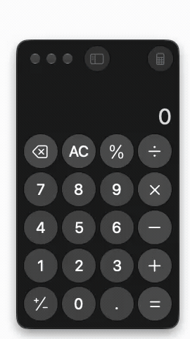

# OpenCUA

[English](README.md) | 简体中文

[](LICENSE)
[](#环境要求)
[](#环境要求)
[](#实现方式)
[](#兼容所有-agent)

OpenCUA 让 AI agent 直接操作 macOS 原生应用——点击按钮、填写输入框、敲快捷键、
滚动页面、拖拽元素。它跑在你自己 Mac 上，是本地服务而不是云端虚拟机；可以当 MCP
服务、命令行工具或 JavaScript 客户端来用，所以 Claude Code、Codex、WorkBuddy、
Trae、Cursor 这类 agent 都能直接驱动它。

它最不同的地方是：你不用把机器让出来。输入直接投递进目标进程，窗口不置前、真实光标
不动、键盘焦点不抢走，agent 操作一个窗口时你可以同时在另一个窗口里打字。而且整段操作
都看得见——目标窗口带蓝色描边和「OpenCUA 正在操作…」徽标，直到这段操作结束才撤。



<sub>真实运行，未经剪辑：对计算器的每个按键各发一次 `cua_click`，输入 `5201314`。你的光标没有移动，焦点始终留在你正在打字的窗口。</sub>

---

## 一句话安装

把下面这段发给你的 agent，装完就是这些：

```
给你自己装上 OpenCUA——一个本地运行的 macOS 计算机操控服务，让你能操作原生应用：

  git clone https://github.com/YuzuSa1t/computer-use-for-mac.git ~/.opencua/src && \
    bash ~/.opencua/src/scripts/install.sh

然后用脚本打印出来的片段把自己注册成 MCP 客户端。接着让我去系统设置里给「OpenCUA
Helper」授予「辅助功能」和「屏幕录制」，再反复执行
`node ~/.opencua/src/server/cua.mjs doctor` 直到 "all_granted" 为 true，最后打开计算器
按一下 7 证明它能用。
```

agent 自己克隆、编译、安装、注册、回报。你要做的只有程序无权代劳的那一件事：  
**点两次「允许」。** 没有 API Key，不用 `npm install`，没有常驻守护进程，不用注册账号。

当它说 `"all_granted": true`，就可以用了。

<details>

<summary>想自己装？</summary>

```bash
git clone https://github.com/YuzuSa1t/computer-use-for-mac.git
cd opencua && ./scripts/install.sh
```

`install.sh` 会编译 helper、安装到 `~/.opencua/bin/`、启动它、检查权限，缺权限时自动  
打开对应的系统设置面板，并打印各家 agent 的注册片段。然后验证：

```bash
node server/cua.mjs doctor     # "all_granted": true 表示两项授权都到位
```

</details>

---

## 兼容所有 agent

没有任何 OpenCUA 专属的集成。会说 MCP 的都能接，能执行 shell 命令的走命令行。

| Agent                               | 接入方式                                                                   |
| ----------------------------------- | ---------------------------------------------------------------------- |
| **Claude Code**                     | `claude mcp add opencua -- node ~/.opencua/src/server/opencua-mcp.mjs` |
| **Codex CLI**                       | `codex mcp add opencua -- node ~/.opencua/src/server/opencua-mcp.mjs`  |
| **WorkBuddy**                       | 写 `~/.workbuddy/mcp.json`（下方 JSON），再到「连接器」里点「信任」启用                     |
| **Trae**（字节跳动）                      | 设置 → MCP → 添加 → 手动添加 → 粘贴下方 JSON                                       |
| **Trace**                           | 任意 MCP 宿主，直接用下方 JSON                                                   |
| **Cursor**                          | `~/.cursor/mcp.json` → 下方 JSON                                         |
| **Cline / Roo Code**                | MCP Servers → Installed → Configure → 粘贴 JSON                          |
| **Windsurf**                        | `~/.codeium/windsurf/mcp_config.json` → 下方 JSON                        |
| **Zed / Continue / Claude Desktop** | 同一段 JSON，传输就是普通 stdio                                                  |
| **Aider / 任何能跑 shell 的 agent**      | 完全不接 MCP：`node server/cua.mjs state Calculator`                        |

通用配置，所有接受 JSON 的客户端都适用：

```json
{
  "mcpServers": {
    "opencua": {
      "type": "stdio",
      "command": "node",
      "args": ["/Users/YOU/.opencua/src/server/opencua-mcp.mjs"]
    }
  }
}
```

两个真的会让人卡一下午的细节：

- **WorkBuddy** 读的是 `~/.workbuddy/mcp.json`——**没有**前缀点，而且要合并进  
  `mcpServers`，不要重写整个文件。写完还需要在连接器列表里启用才会加载。
- **Trae** 的项目级 MCP 默认是关的。从「设置 → MCP」添加即刻生效；放进  
  `.trae/mcp.json` 的话还要额外打开「启用项目级 MCP」开关。

客户端会拿到 13 个 `cua_*` 工具，操作手册只在 `initialize.instructions` 里下发一次，  
单个工具描述保持一行——让模型把注意力放在任务上，而不是管线细节上。

服务端只是一个薄薄的 stdio 桥接层，不是托管运行时，所以同一份安装同时服务这台机器上的  
所有 agent；你授权过一次，helper 重启后依然有效。

---

## 为什么它不一样

> 给你的 agent 一双手，而不是把你的 Mac 交出去。

**快。** 按压元素就是一次 AX 调用：**约 40ms**。开光标时点击会等约 300ms 让指针先落位  
——动作跟着指针走，不能反过来。这两条路径都不是「每步截一张图」的循环。

| 操作                    | 耗时      |
| --------------------- | ------- |
| 按压元素（`cua_click` 传元素） | 约 40ms  |
| 按压元素，开可见光标            | 约 340ms |
| 按压元素，`instant: true`  | 约 30ms  |
| 读取状态（仅树）              | 约 55ms  |
| 读取状态（树 + 截图）          | 约 75ms  |
| 按键组合                  | 约 65ms  |

**准。** macOS 自带一棵真正的辅助功能树，OpenCUA 直接读它。按钮就是按钮，有名字有坐标  
范围，不是从像素里猜出来的矩形。元素按身份直接按压——不用坐标、不做 OCR、视觉模型不在  
链路里，也不会出现「点偏了 4 像素」。坐标只在视图里确实没有可按压元素时兜底，且截图过期  
会返回 `VIEW_STALE`，而不是点在刚移到那个位置的别的东西上。

**不打扰，是结构决定的。** 这部分没法事后补：

- 真实指针从不被挪动。你看到的光标画在一个覆盖层里；点击由 `CGEventPostToPid`  
  直接投递给目标进程。
- 目标窗口从不被激活。它可以一直待在你的编辑器后面。
- 键盘焦点从不被抢走。agent 干活时你可以继续打字。

**看得见。** 沉默才是自动化让人害怕的原因。agent 工作时，目标窗口带一圈蓝色描边和一个  
常驻徽标 **OpenCUA 正在操作计算器**，光标滑到每个目标，每次按压落下一个圆点加一圈波纹。  
徽标是*状态*而不是通知：整段操作期间一直在，操作结束才走。详见  
[过程可见](#过程可见)。

|          |                                  |
| -------- | -------------------------------- |
| **后台执行** | 输入直接投递到目标进程，不激活窗口、不移动光标。         |
| **元素优先** | 原生辅助功能树，按身份直接按压；坐标仅作兜底。          |
| **过程可见** | 常驻窗口描边 + 徽标、滑动光标、点击波纹。           |
| **按需存活** | 不是守护进程。干完活自己退出，下次调用约 0.7 秒懒启动。   |
| **安全闸门** | 黑名单、锁屏熔断、可选逐应用审批、过期视图拒绝。         |
| **载荷精简** | 计算器一次状态读取约 3.2KB 文本（35 个节点）加一张图。 |
| **零依赖**  | 不装任何 npm 包，没有运行时要安装，不联网。         |

---

## 实现方式

```
┌─────────────────────────────────────────────────────────────┐
│  Agent — Claude Code / Codex / WorkBuddy / Trae / Trace     │
│          Cursor / Cline / Windsurf / 任意 MCP 客户端        │
└──────────────────────────┬──────────────────────────────────┘
                           │  MCP over stdio   ·   或 CLI
┌──────────────────────────▼──────────────────────────────────┐
│  server/opencua-mcp.mjs   ·   server/cua.mjs                │
│  零依赖 Node 桥接层 — 13 个工具，不引入任何 npm 包          │
└──────────────────────────┬──────────────────────────────────┘
                           │  按行分隔的 JSON-RPC
                           │  ~/.opencua/helper.sock
┌──────────────────────────▼──────────────────────────────────┐
│  OpenCUA Helper.app — Swift，LSUIElement（无 Dock 图标）    │
│  TCC 权限的唯一持有者                                       │
│                                                             │
│  AXEngine       辅助功能树、元素按压                        │
│  EventEngine    CGEvent 合成（点击/按键/输入）              │
│  ScreenEngine   窗口截图 + view 坐标系映射                  │
│  CursorOverlay  动画软件光标（纯视觉）                      │
│  PolicyEngine   黑名单、审批、锁屏熔断                      │
│  RPCServer      Unix socket JSON-RPC + 空闲看门狗           │
└─────────────────────────────────────────────────────────────┘
```

这个分层只为一件事：**TCC 权限属于 bundle，不属于你的 agent。** 给  
`OpenCUA Helper.app` 授权一次，所有客户端——命令行、MCP 宿主、测试脚本——共享这份授权，  
不再弹窗。helper 是机件，桥接层随时可丢。

读是原生接口调用，不是模型推理：辅助功能树直接给出角色、标识、值和坐标范围。写也是原生  
接口调用——元素走 AX 按压，没有元素时向目标 pid 投递合成的 `CGEvent`。这就是为什么两者  
都以几十毫秒计，也是为什么它们能操作一个待在你编辑器后面的应用。

---

## 安全

所有操作在执行前先过策略闸门。这些不是提醒，每一条都会直接拒绝调用。

- **黑名单**——直接拒绝：终端、iTerm2、`loginwindow`、`SecurityAgent`、  
  `systemuiserver`、「安全性与隐私」设置面板、钥匙串访问、密码、1Password、  
  锁屏相关进程以及 helper 自身。可通过 `cua_policy` 或 `~/.opencua/config.json` 扩展。
- **锁屏熔断**——屏幕锁定时所有操作返回 `LOCKED`。没人在看着的机器上什么都不会跑。
- **逐应用审批**——为开箱即用，未知应用默认放行。设置 `auto_approve: false`  
  （或 `OPENCUA_AUTO_APPROVE=0`）改为逐应用显式审批；支持 elicitation 的 MCP  
  客户端会收到确认提示，其余客户端得到 `NOT_APPROVED` 而不是被执行。
- **过期视图拒绝**——窗口在截图后移动过，坐标点击返回 `VIEW_STALE`，而不是点错位置。
- **它无法自行提权。** helper 以你的身份运行，没有特权，也无法给自己授予权限。它不能  
  替你确认系统弹窗、读不到钥匙串、也打不进系统持有的密码框。
- **数据不出机器。** 没有埋点、没有云端往返、不需要 API Key。截图进内存后交给发问的  
  客户端。
- **它会结束。** helper 不是守护进程——干完活退出，下次懒启动。见[生命周期](#生命周期)。

错误码稳定且明确：`APP_BLOCKED`、`NOT_APPROVED`、`LOCKED`、`VIEW_STALE`、  
`TARGET_NOT_FOUND`、`BAD_ELEMENT`、`NO_WINDOW`、`NO_FIELD`、`CAPTURE_FAILED`、  
`SET_FAILED`、`EVENT_FAILED`、`AX_FAILED`、`AX_ACTION_FAILED`、`OPEN_FAILED`。  
请求本身畸形时另有 `BAD_PARAMS`、`UNKNOWN_METHOD`；完整列表见  
[docs/protocol.md](docs/protocol.md)。

---

## 过程可见

一个悄无声息干活的 agent 和出了 bug 的软件没有区别——窗口自己变了，却没人解释为什么。  
三层信号回答同一个问题「是不是有什么东西正在操作我的 Mac？」，其中只有第一层是状态，  
其余两层是事件。

1. **接触**——被操作的窗口浮出一圈蓝色描边，沿窗口轮廓画完后**留在原地**，上方弹出小  
   胶囊：**OpenCUA 正在操作计算器**。两者都持续到这段操作结束——两秒就消失的徽标会让  
   每一个长任务的后半程都失去解释。
2. **存在**——光标沿一段短弧滑到每个目标，身后拖一条短短的尾迹，让每个动作既有明确的  
   操作者、也有明确的方向。光标被限制在目标窗口内，绝不会画到别的窗口上。
3. **触感**——接触瞬间光标下沉、触点浮出一个小圆点、单圈波纹扩散。只有描边没有填充：  
   一块实心圆看起来像凭空出现的蓝块，而不像一次点击。

改动前值得知道的几条约束：

- **提示不会说谎。** 它的寿命和这串操作一样长：最后一个客户端断开时结束，或静默  
  `OPENCUA_ENGAGEMENT_IDLE` 秒后结束——绝不是「直到进程退出」，因为客户端可能一直连着  
  而人正在读屏幕。
- **它不会指错窗口。** 目标被别的应用遮挡时不画描边也不弹徽标；已经画着的会在两秒内  
  撤掉。给一个看不见的窗口描边，等于在人真正看着的东西上画框，还标错了名字。
- **不会重复刷屏。** 连续四十次点击算一次连续提示；同一应用需静默  
  `OPENCUA_ANNOUNCE_GAP` 秒后才会重新提示。
- **不会凭空编造方向。** 只有上一步动作就在同一个窗口内时才画尾迹；否则光标直接在目标处  
  淡入——从窗口边缘拉一条线，看起来像一根从屏幕外伸进来的电线。
- **代价是一次手势，不是一段等待。** 点击会等约 300ms 让光标先落位。单次调用传  
  `instant: true`、或脚本循环里设 `OPENCUA_CURSOR=0`，延迟降到约 30ms。
- **绝不阻塞。** 所有动效都是装饰，覆盖层里的任何代码都不得延迟或改变动作本身。

徽标跟随系统语言——中文环境下就是上图里的「OpenCUA 正在操作计算器」。可用  
`OPENCUA_LANG=zh` / `en` 强制指定。整体关闭用 `OPENCUA_ANNOUNCE=0`（只关光标用  
`OPENCUA_CURSOR=0`）。

---

## 环境要求

- macOS 13（Ventura）或更高
- Xcode Command Line Tools（提供 `swiftc`）
- Node.js 18 或更高
- 为 `OpenCUA Helper.app` 授予「辅助功能」与「屏幕录制」

装好后验证：

```bash
node server/cua.mjs doctor
```

`"all_granted": true` 表示两项都已就绪。

> **重新编译会使授权失效。** bundle 使用 ad-hoc 签名，每次重建签名标识都会变，  
> macOS 会当成一个新应用。用 Developer ID 证书签名可得稳定标识，否则重建后需重新添加。

只构建不安装：

```bash
./scripts/build.sh          # → dist/OpenCUA Helper.app + CLI 软链
```

---

## 快速开始

### 作为 MCP 服务

```bash
claude mcp add opencua -- node /absolute/path/to/opencua/server/opencua-mcp.mjs
```

其他客户端用[兼容所有 agent](#兼容所有-agent)里的 JSON。

### 作为命令行

```bash
node server/cua.mjs apps                       # 有哪些应用在运行
node server/cua.mjs state Calculator           # 元素树 + 截图
node server/cua.mjs click Calculator --element 20 --state <state_id>
node server/cua.mjs type Notes "你好 世界" --element 58
node server/cua.mjs key Safari cmd t
node server/cua.mjs open Calculator
node server/cua.mjs shot Calculator -o calc.png
node server/cua.mjs doctor
```

`install.sh` 同时会把 CLI 软链到 `~/.opencua/bin/cua`。`cua apps` 输出对齐的表格，  
加 `--json` 可拿到原始载荷。

### 在自己的代码里调用

```js
import { HelperClient } from "./server/lib/client.mjs";

const cua = new HelperClient();

const state = await cua.call("app.state", { target_id: "Calculator" });
const button = state.tree.find((n) => n.id === "Seven");

await cua.call("input.click", {
  target_id: "Calculator",
  state_id: state.state_id,
  element: button.i,
});

cua.close();   // helper 会在稍后自行退出
```


---

## 工具

| 工具                | 用途                                      |
| ----------------- | --------------------------------------- |
| `cua_apps`        | 列出运行中的应用及其 `target_id`                  |
| `cua_app_state`   | 元素树、截图、`state_id`、`view_id`             |
| `cua_click`       | 按元素索引点击（AX 按压），或按 view 像素坐标 `[x, y]` 点击 |
| `cua_type`        | 向输入框写入文本：AX 赋值或键盘事件                     |
| `cua_key`         | 按快捷键组合，如 `["cmd", "c"]`                 |
| `cua_scroll`      | 在指定像素点滚动                                |
| `cua_drag`        | 从一个点拖到另一个点                              |
| `cua_screenshot`  | 截取窗口为图片                                 |
| `cua_open_app`    | 后台启动应用                                  |
| `cua_open_url`    | 打开 URL，可指定应用                            |
| `cua_permissions` | 查询 TCC 权限状态                             |
| `cua_policy`      | 查看或修改应用白名单                              |
| `cua_stop`        | 立即停止 helper                             |

### 操作循环

```
cua_apps → cua_app_state(target_id) → 操作 → cua_app_state → …
```

看屏幕、操作、再看屏幕——和人做事的顺序一致。每次有意义的操作之后都要重新读取状态，  
不要假设操作已经生效：输入被静默丢弃是这类工具无法预防、只能发现的失败模式。

`cua_app_state` 返回：

```json
{
  "target_id": "com.apple.calculator",
  "state_id": "…",
  "tree": [{ "i": 0, "p": -1, "role": "AXWindow", "title": "计算器",
             "frame": [2890, 417, 230, 408], "kids": 5 }],
  "view": { "view_id": "…", "width": 276, "height": 454, "scale": 1.2 }
}
```


每个节点是 `{ i, p, role, id, title, desc, value, frame, kids, press }`：  
`i` 是元素索引，`p` 是父节点索引（窗口为 `-1`），`kids` 是子节点数量，  
`press: true` 表示该元素支持 AX 按压。`id`、`title`、`desc`、`value` 为空时不输出，  
所以载荷只携带应用真实暴露的信息。

---

## 生命周期

helper 是工具，不是守护进程。它会自己退出，需要时再起来。

| 条件                                  | 默认       | 覆盖方式                   |
| ----------------------------------- | -------- | ---------------------- |
| 最后一个客户端断开                           | 20 秒后退出  | `OPENCUA_EXIT_GRACE`   |
| 客户端仍连着但一直不发请求                       | 900 秒后退出 | `OPENCUA_IDLE_TIMEOUT` |
| `cua_stop` / `cua stop` / `SIGTERM` | 立即退出     | —                      |

退出时会关闭监听口、删除 socket 文件、撤掉光标面板——不留孤儿连接，也不在屏幕上  
留下看不见的面板。

- 重启是懒的：下一次调用在约 0.7 秒内拉起新 helper。TCC 授权按 bundle 标识复用，  
  不会重新弹窗。
- 锁文件 `~/.opencua/helper.lock` 保证单实例。多个客户端同时启动只会活下来一个，  
  不会出现两个进程抢同一个 socket。
- 生命周期策略随客户端走：连接时会把 `OPENCUA_EXIT_GRACE` 和 `OPENCUA_IDLE_TIMEOUT`  
  下发给 helper，所以即使 helper 是被别的进程启动的，你的设置依然生效。
- 高频脚本场景可用 `OPENCUA_KEEP_ALIVE=1` 让它常驻。

```bash
node server/cua.mjs start    # 预热
node server/cua.mjs stop     # 立即停止
```

---

## 坐标系

这里涉及三套坐标，混淆它们是最常见的集成错误。

| 坐标空间    | 使用方                          | 原点      |
| ------- | ---------------------------- | ------- |
| 全局左上    | AX frame、`CGWindowList` 窗口边界 | 主显示器左上角 |
| AppKit  | `NSPanel`、`NSScreen`         | 左下角     |
| view 像素 | agent 传入的 `[x, y]`           | 截图左上角   |

`cua_app_state` 会返回 `view.width`、`view.height` 和 `scale`；坐标一律按该像素空间  
解释，由 helper 映射回全局点。若为一个 230×378 pt 的窗口截出 276×454 的图，  
`scale` 为 1.2，像素 `[0, 0]` 对应窗口左上角。

传坐标时把同一个 `view_id` 一起传回。重新截图会让旧的 view 失效。

---

## 输出约定

返回内容为机器消费而设计，不为叙事服务。

- `cua_app_state` 返回紧凑的元素树，截图作为独立的 MCP image part——绝不塞成文本里的 base64。
- 点击返回 `{"ok": true, "route": "ax"}`，不带提示语，不带逐步说明。
- `cua_apps` 只返回 `target_id` 和 `name`；`focused`、`operable`、`blocked` 仅在为真时出现。
- 工具调用在桥接层内串行执行。计算机操作本质是顺序的（一个窗口、一个焦点、一个光标），  
  宿主把多个调用流水线发来时会按到达顺序执行，而不是互相竞争。

`initialize.instructions` 同时要求调用方用一到两句话回答做了什么、屏幕上有什么变化，  
不要复述元素索引、路由名或 helper 内部状态。

---

## 配置

`~/.opencua/config.json` 在首次写入时创建：

```json
{
  "version": 1,
  "cursor": true,
  "auto_approve": true,
  "allow": [],
  "deny": []
}
```

| 键              | 默认     | 含义                         |
| -------------- | ------ | -------------------------- |
| `cursor`       | `true` | 显示软件光标                     |
| `announce`     | `true` | 描出窗口轮廓并显示「OpenCUA 正在操作…」   |
| `auto_approve` | `true` | 未知应用免审批放行                  |
| `allow`        | `[]`   | 始终允许的 `target_id`          |
| `deny`         | `[]`   | 追加屏蔽的 `target_id`（在内置列表之外） |

环境变量：

| 变量                        | 默认    | 含义                              |
| ------------------------- | ----- | ------------------------------- |
| `OPENCUA_EXIT_GRACE`      | `20`  | 最后一个客户端离开后的存活秒数。`0` 立即退出，负数永不退出 |
| `OPENCUA_IDLE_TIMEOUT`    | `900` | 客户端仍连着但无请求的退出秒数。`0` 关闭          |
| `OPENCUA_KEEP_ALIVE`      | —     | `1` 关闭所有自动退出                    |
| `OPENCUA_CURSOR`          | —     | `0` 隐藏软件光标                      |
| `OPENCUA_ANNOUNCE`        | —     | `0` 关闭窗口描边与控制徽标                 |
| `OPENCUA_ENGAGEMENT_IDLE` | `30`  | 静默多少秒后撤掉常驻的描边与徽标                |
| `OPENCUA_LANG`            | 系统    | `zh` 或 `en`，仅影响徽标文案             |
| `OPENCUA_ANNOUNCE_GAP`    | `60`  | 同一应用再次提示所需的静默秒数                 |
| `OPENCUA_AUTO_APPROVE`    | `all` | `none`、`all`，或逗号分隔的白名单          |
| `OPENCUA_HELPER`          | —     | 指定 helper 二进制路径                 |

---

## 故障排除

**`tree_error` 或元素树为空**  
辅助功能权限缺失，或已被重新编译作废。在系统设置 → 隐私与安全性 → 辅助功能里删除旧条目，  
重新添加 `~/.opencua/bin/OpenCUA Helper.app`，然后  
`node server/cua.mjs stop` 后重试。

**截图空白 / `view_error`**  
屏幕录制权限缺失。同一个面板的另一页。较新的 macOS 上修改该权限需要重启 helper。

**点击返回 `ok` 但没有反应**  
元素树里没有可按压节点，请求退回了坐标路径。发给**非前台应用**的合成事件会被  
较新的 macOS 静默丢弃——见「已知限制」。改用 `press: true` 的元素。

**`BAD_ELEMENT`**  
`state_id` 失效了。元素索引只在它来源的那次状态里有效，重新调用 `cua_app_state`。

**中文输入乱码**  
使用默认的 AX 输入模式（`cua_type` 不传 `mode`），它直接写入字段值，不经过输入法。  
`mode: "keyboard"` 只为不响应 AX 的应用保留。

**任务结束后 helper 还在跑**  
正常情况下不会。用 `doctor` 查看当前的 `auto_exit` 策略，并确认没有客户端还握着连接  
——任何打开的 socket 都会重置宽限计时。

---

## 已知限制

- **后台输入有硬上限。** AX 按压对任何应用都有效，无论是否在前台；但坐标点击、快捷键和  
  键盘输入是通过 `CGEventPostToPid` 投递给目标进程的，较新的 macOS 会在目标非前台时  
  丢弃这类事件。调用返回成功只说明事件已入队，应用其实忽略了它。这是「绝不抢焦点」的  
  代价，而且是刻意选择：激活目标能修好输入，但会打断用户。优先使用元素级操作。
- **无法操作特权界面。** 系统安全提示、系统持有的密码框、黑名单内的一切都不能自动化。
- **窗口截取使用 `CGWindowList` 接口**，该接口已标记废弃，但在当前系统上仍可用。  
  它能截取被其他窗口遮挡的窗口，这一点 `ScreenCaptureKit` 做不到同样简单。
- **单一显示器坐标空间。** 坐标按包含该点的屏幕做映射，跨屏窗口的映射可能不精确。
- **ad-hoc 签名。** 重新编译会改变签名标识，macOS 会再次索要权限。用 Developer ID  
  签名可获得稳定的授权。

---

## 项目结构

```
.
├── .github/workflows/build.yml        CI — swift build + node --check
├── swift/
│   ├── Package.swift
│   └── Sources/opencua-helper/
│       ├── main.swift                 入口、生命周期信号
│       └── Core/
│           ├── Support.swift          常量、日志、JSON 辅助
│           ├── AXEngine.swift         辅助功能树、元素按压、状态存储
│           ├── EventEngine.swift      CGEvent 合成
│           ├── ScreenEngine.swift     窗口截图、view 坐标
│           ├── CursorOverlay.swift    动画软件光标
│           ├── PolicyEngine.swift     审批、黑名单、锁屏
│           ├── AppInventory.swift     应用清单、窗口、启动
│           ├── Ops.swift              操作编排
│           └── RPCServer.swift        socket 服务、看门狗、退出
├── server/
│   ├── opencua-mcp.mjs                MCP 服务（13 个工具）
│   ├── cua.mjs                        命令行
│   └── lib/client.mjs                 helper 连接层
├── scripts/
│   ├── build.sh                       编译 + 组装 .app
│   └── install.sh                     安装 + 权限引导
├── docs/
│   ├── demo.gif                       顶部演示
│   └── protocol.md                    原始 JSON-RPC 参考
├── examples/calculator.mjs            可运行的端到端示例
├── CONTRIBUTING.md
├── LICENSE
├── README.md
└── README.zh-CN.md
```

## 开发

```bash
cd swift && swift build -c release --disable-sandbox   # 仅编译
./scripts/build.sh                                     # + 组装、签名
./scripts/install.sh                                   # + 安装、启动
node server/cua.mjs doctor                             # 冒烟测试
```

桥接层没有构建步骤也没有依赖——纯 ESM，所以 `node server/cua.mjs` 永远跑的是当前代码。  
修改 Swift helper 需要重新编译，修改桥接层不需要。

CI 在每次推送时执行 `swift build` 和全量脚本的 `node --check`。  
完整流程见 [CONTRIBUTING.md](CONTRIBUTING.md)。

## 许可证

[MIT](LICENSE)
